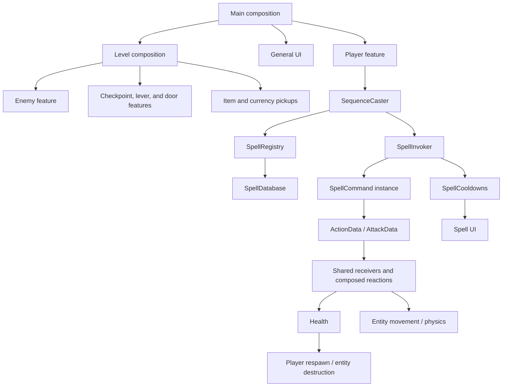

# Architecture

This Godot game uses feature-driven organization and composition over inheritance. A feature owns its scenes, scripts, resources, presentation, and dedicated artwork. Entity controllers coordinate focused components; shared components are extracted when multiple features actually consume them. `AGENTS.md` contains the project-wide conventions.

## Project organization

```text
Main.tscn / main.gd                Application composition and dependency wiring
events.gd                         Cross-feature event signals
entities/
  player/                         Player controller, inventory, equipment, stats, sprites
    input/                        Player aim input
    interaction/                  Nearby selection, input routing, and interaction prompt
    movement/                     Player jump and knockback components
    reactions/                    Player action reactions
    respawn/                      Player spawn/checkpoint state and death response
  npcs/village_guide/             Stationary guide, copied sprite assets, and introduction dialogue
  npcs/movement/                  NPC stationary body physics using shared gravity
  enemies/
    basic_skeleton/               Concrete enemy scene, controller, and sprites
    combat/                       Enemy melee, hitbox, and contact behavior
    detection/                    Enemy target detection
    platform_crawler/             Enemy that loops around one platform and charges forward
    respawn/                      Enemy recreation after player death or checkpoint rest
  interactive/
    checkpoint/                   Reusable checkpoint scene, logic, and menu
    door/                         Door scene and controller
    lever/                        Physical lever, presentation, and push reaction
  items/
    item_definition.gd            Public item metadata contract
    definitions/                  Concrete item resources
    pickup/                       Item pickup scene and interaction script
    reactions/                    Physics-item action reactions
    sprites/                      Item-specific artwork and source files
  dummy/                          Combat test entity and its damage animation
currency/
  coin_manager.gd                 Autoload owning the currency total
  drop/                           Death-triggered Stardust drops composed into enemies
  pickup/                         Currency pickup scene and behavior
  ui/                             Currency display
health/                           Shared health and generic death policies
save/                             SaveGame autoload: persists progress when resting at checkpoints
spells/
  core/                           Casting, definitions, registry, database, cooldowns
  action/                         Action contracts and concrete action spells
  attack/                         Attack contracts, spell commands, and projectiles
  dash/ / double_jump/            Concrete movement spells
  ui/                             Spell sequence, cooldown, and registry presentation
dialogue/                         Shared dialogue resources, active session, and panel
  interaction/                    Composed target-to-dialogue behavior
components/                       Components with consumers across features
  interaction/                    NPC/checkpoint interaction contract
levels/level_01/                  Level composition, camera, and level artwork
ui/                               General menus and the player HUD
assets/pickups/                   Placeholder artwork shared by items and currency
prototypes/                       Background rendering experiment and debug artwork
  editor_recovery/                Historical editor snapshots, excluded from imports
tests/                            Feature suites and the shared headless runner
docs/specs/                       Feature behavior and acceptance criteria
```

## Ownership and dependencies

| Owner | Authoritative state or responsibility |
| --- | --- |
| `SpellDatabase` | Shared catalogue of spell definitions. |
| `SpellRegistry` | One player's registered spell IDs. |
| `SpellCooldowns` | Active cooldown end times, accepted durations, and start order. |
| `DialogueSession` | Active conversation, current line, interruption subscriptions, and completion. |
| `PlayerInteractor` | Nearby interaction candidates, selected target, and interaction/cancel input. |
| `Health` | Health, shield, and depletion events. |
| `Inventory` / `Equipment` | Item quantities and equipped slots, changed through public APIs. |
| `RespawnOnDeath` | Player spawn position, checkpoint, and respawn lifecycle. |
| `EnemyRespawner` | Placed enemy definitions and transforms used for recreation. |
| `SwitchComponent` | Discrete switch state consumed by doors. |
| `CoinManager` | Currency total and its change signal. |
| `SaveGame` | The save file; captures and restores other owners' state only through their public APIs. |

`Main` composes the level and application UI and supplies player dependencies to the pause menu. Features exchange data through public methods, typed data objects, signals, and explicitly assigned references. Components do not discover unrelated nodes by traversing arbitrary paths.

The player owns its movement coordination and exposes narrow capabilities such as `try_spell_jump()`, `collect_item()`, and `set_checkpoint()`. Checkpoints request a rest through `rest_at_checkpoint()`; `RespawnOnDeath` owns the resulting checkpoint and health restoration, and announces it with `Events.checkpoint_rested`. `RespawnOnDeath` emits lifecycle signals so the player can clear movement modes before position and health are restored.

The `Events` autoload publishes `player_died` and `item_collected`. The enemy respawner and item-notification display subscribe to those public events. It owns no gameplay state. The `CoinManager` autoload is the currency feature's application-lifetime state owner.

Shared `components/` contains the action/attack receiver contracts, health damage reaction, switch state, gravity, horizontal movement, and character-to-rigid-body pushing. Player-only movement and input components remain inside the player feature. Generic behavior may move to shared components when a second feature demonstrates reuse.

## Runtime flow



Commands and projectiles own their temporary lifetime. UI observes authoritative gameplay state and requests changes through APIs. Shared resources contain configuration; per-player and per-entity runtime state remains in node components.

## Working on a feature

Read its specification, keep new files with its owner, and update explicit references when moving resources. Preserve script and asset UID sidecars during moves. Keep scripts beside their scenes or in focused subdirectories within the feature. Use `tests/` and `docs/specs/` for feature verification and contracts; see `TESTING.md` for execution details.

## NPC interaction and dialogue

`InteractionTarget` detects eligible player overlap and registers with the player's public `get_interactor()` capability. `PlayerInteractor` selects one nearby NPC or checkpoint and routes each interaction press once. NPC scenes compose `DialogueInteraction`, which binds their interaction target to a read-only `DialogueDefinition` and the `DialogueSession` composed in `Main`. The NPC root needs no dialogue script. The guide composes `StationaryNpcBody` with shared gravity, a solid character body, and an animated sprite copied into its own assets directory. `Main` supplies the session to the dialogue interaction component and player interactor; it also supplies the session with player health and respawn lifecycle dependencies.

Dialogue keeps movement, casting, enemies, and physics active. The session observes range loss, health damage, respawn, and participant removal; the panel derives its display from session state. Existing menus retain pause ownership. During pause the active conversation is preserved and hidden, and dialogue input is suspended. See `specs/011_npcs_and_dialogue.md` for contracts and interruption rules.
