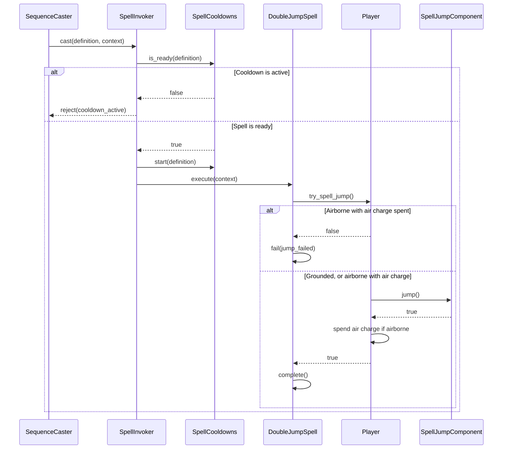

# Feature Overview

Add a **Double Jump** movement spell that applies an upward jump impulse when it is successfully cast. The spell works while the player is standing on the floor or airborne, regardless of how the player became airborne.

The spell uses the sequence **Circle, Triangle** followed by the normal cast-confirm input. These buttons map to the project's internal `[move, interaction]` tokens. The spell is catalogued in the shared `SpellDatabase` and registered to the player by default.

Double Jump has two repeat-use restrictions:

- A short time-based **cooldown**, owned by `SpellCooldowns`, rate-limits every cast.
- A single **air charge**, owned by the `Player`, allows only one airborne spell jump per airborne period. Touching the floor recharges it.

Casting from the floor never spends the air charge. A player can therefore cast from the floor, then cast once more in midair after the cooldown expires, and must land before another airborne cast.

## Goals

- Add one simple, self-contained movement spell using the existing sequence-casting pipeline.
- Allow the spell to jump from the floor or redirect the player upward in midair.
- Limit airborne use to one spell jump per airborne period, recharged by landing.
- Use `SpellCooldowns` as the authoritative time-based availability state.
- Keep the vertical-impulse behavior in a stateless composed movement component.
- Keep the air charge in the entity that coordinates movement modes.
- Preserve the player's horizontal momentum when the spell succeeds.

## Non-Goals

- Requiring a normal jump before the spell can be used in midair.
- More than one airborne charge, or charges restored by anything other than floor contact or respawn.
- Resetting or modifying the cooldown when the player lands.
- Mana costs, shared cooldown groups, or cooldown-reduction modifiers.
- Coyote time, jump buffering, or variable height for the spell jump.
- An air-charge HUD indicator.
- New animation, particles, sound, camera shake, or final icon artwork.
- Changing the behavior or balance of the player's normal jump.

# Behavior Rules

## Availability

- The cooldown gate applies first: the spell can be accepted only when `SpellCooldowns.is_ready()` returns `true` for its definition.
- Being on the floor is valid and does not spend the air charge.
- Rising, falling, or being at the jump apex is valid while the air charge is available.
- Walking or falling off a ledge without first jumping is valid; the player left the floor with a full air charge.
- A successful airborne cast spends the air charge.
- While the air charge is spent, airborne casts do not jump, even after the cooldown expires.
- Any physics frame in which the player is on the floor restores the air charge.
- Respawning restores the air charge.
- Landing does not finish, restart, shorten, or otherwise modify the cooldown.
- Unregistering and re-registering the spell clears neither an active cooldown nor a spent air charge.

The name **Double Jump** describes the intended use: a floor jump (normal or spell) followed by one spell jump in midair.

## Successful Cast

- Set the player's vertical velocity to the configured spell-jump velocity. Assigning the value directly produces a consistent impulse whether the player is grounded, rising, falling, or at the apex.
- Preserve horizontal velocity and facing direction.
- When the player was airborne at the moment of the cast, spend the air charge.
- Play the existing `jump` animation when it is not superseded by a higher-priority animation such as `hit`.
- Do not route the spell through `JumpBufferComponent`, `CoyoteTimeComponent`, or `VariableJumpHeightComponent`.
- Start the configured cooldown through `SpellInvoker`, using `SpellCooldowns` as the source of truth.
- Complete the `SpellCommand` immediately after the movement component applies the impulse.

The initial spell-jump velocity should match the effective normal `jump_velocity` configured in `Player.tscn`. The component keeps this value exported so it can be tuned independently later.

## Cooldown Rejection

The initial cooldown is `0.25` seconds.

When the player confirms the sequence during cooldown:

- `SpellInvoker` rejects the cast with `cooldown_active`.
- No `DoubleJumpSpell` command is created or executed.
- Velocity, the air charge, and the current movement mode remain unchanged.
- The existing cooldown keeps its original end time and is not restarted.
- The cooldown HUD keeps exactly one entry for the spell.
- `SequenceCaster` clears the confirmed input sequence according to its existing behavior.

## Spent Air Charge Rejection

When the player confirms the sequence while airborne with the air charge spent and the cooldown ready:

- `SpellInvoker` accepts the cast and starts the cooldown, because the invoker gates only on cooldown.
- `Player.try_spell_jump()` returns `false` before touching any movement mode.
- `DoubleJumpSpell` fails with `jump_failed` and frees itself.
- Velocity is unchanged, so gravity continues to act normally.
- Dash, jump-down, and knockback are not cancelled.
- The air charge stays spent until the player touches the floor or respawns.

Starting the cooldown on this rejection is current behavior, not a design requirement. It is harmless because the player cannot spell-jump again until landing, and landing usually takes longer than the cooldown.

# Implementation Details

## Composition

The upward impulse belongs to a focused movement component composed into the player. The air charge is movement-mode coordination state, so it belongs to the `Player`, beside dash and jump-down coordination. The spell command requests the capability through the caster and must not modify `CharacterBody2D.velocity` or search the caster's child nodes directly.

```text
Player (CharacterBody2D)            owns the air charge
├── SpellJump (SpellJumpComponent)  stateless impulse
├── JumpDown (JumpDownComponent)
├── Knockback (KnockbackComponent)
├── RespawnOnDeath
├── SpellRegistry
├── SequenceCaster
├── SpellCooldowns
└── SpellInvoker

DoubleJumpSpell (SpellCommand)
```

| Component | Responsibility |
|-----------|----------------|
| `SpellJumpComponent` | Apply the configured upward velocity to its body. It owns no cooldown, floor, or charge state. |
| `Player` | Own the single air charge, coordinate the jump impulse with other movement modes, and expose a narrow spell-facing capability. |
| `RespawnOnDeath` | Emit `respawning`, which the player uses to restore the air charge. |
| `DoubleJumpSpell` | Validate the caster capability, request a spell jump, and complete or fail. |
| `SpellDefinition` | Provide spell metadata, sequence, cooldown duration, and command scene. |
| `SpellDatabase` | Catalogue the Double Jump definition. |
| `SpellRegistry` | Decide whether the player's sequence caster may resolve Double Jump. |
| `SpellCooldowns` | Own the authoritative time-based availability state. |
| `SpellInvoker` | Reject casts during cooldown and start cooldown for accepted casts. |

## SpellJumpComponent

`entities/player/movement/spell_jump_component.gd` with class name `SpellJumpComponent`. Its public contract remains small:

```gdscript
class_name SpellJumpComponent
extends Node

@export var body: CharacterBody2D
@export var jump_velocity: float = -1000.0

func jump() -> bool
```

- `jump()` returns `false` if `body` is missing.
- On success, `jump()` assigns `body.velocity.y = jump_velocity` and returns `true`.
- It never reads floor contact, input, coyote time, landing state, or another movement component.
- It does not count jumps or store the air charge; that state belongs to `Player`.
- It does not create a timer or query `SpellCooldowns`.
- It preserves `body.velocity.x`.
- A missing `body` is a configuration error reported clearly and handled without crashing.

## Player Integration

Expose `try_spell_jump() -> bool` as the narrow capability used by `DoubleJumpSpell`. The player stores the charge in a private `_has_air_spell_jump: bool`, initially `true`.

`Player.try_spell_jump()`:

1. Records whether the cast is airborne (`not is_on_floor()`).
2. If airborne and the charge is spent, returns `false` without changing any state.
3. Ends an active dash, so the next dash update cannot replace the new vertical velocity with zero.
4. Cancels an active jump-down through `JumpDownComponent.cancel()`, restoring the one-way platform collision mask before the impulse.
5. Keeps horizontal knockback state and applies only the vertical impulse.
6. Delegates to `SpellJumpComponent.jump()` and returns `false` if it fails, leaving the charge unspent.
7. If the cast was airborne, spends the charge.
8. Requests the existing `jump` animation and returns `true`.

Charge restoration:

- `_physics_process()` restores the charge on every frame in which `is_on_floor()` is `true`, after movement for that frame.
- `_reset_movement_for_respawn()`, connected to `RespawnOnDeath.respawning`, restores the charge together with the other movement-mode resets.

The player must not implement another cooldown, and no other component may keep a second copy of the charge.

## Spell Command and Cooldown Lifecycle

`spells/double_jump/double_jump_spell.gd` and `spells/double_jump/DoubleJumpSpell.tscn`. `DoubleJumpSpell` extends `SpellCommand` and has no persistent state.



The command guards against a null context/caster and against a caster without `try_spell_jump()`. Failure reasons are:

- `missing_caster`
- `unsupported_caster`
- `jump_failed`: the caster refused the jump, either because the air charge is spent or because `SpellJumpComponent` is misconfigured.

All failures use the normal `SpellCommand.fail()` lifecycle, and the command must never remain in the scene tree after completing or failing.

## Spell Definition and Registration

`spells/double_jump/double_jump_spell_definition.tres` uses the following metadata:

| Property | Value |
|----------|-------|
| `id` | `double_jump` |
| `display_name` | `Double Jump` |
| `description` | `Jump upward from the floor or in midair.` |
| `sequence` | `[move, interaction]` (Circle, Triangle) |
| `cooldown` | `0.25` seconds |
| `command_scene` | `DoubleJumpSpell.tscn` |

Use a safe placeholder icon if the registry or cooldown UI requires one; final artwork is out of scope. The definition is in `spells/spell_database.tres`, and `double_jump` is in the Player's `SpellRegistry.initial_spell_ids` after the existing starting spells.

The one-token Dash sequence (`[move]`) and the Double Jump sequence (`[move, interaction]`) are distinct because sequence resolution occurs only after the player presses cast confirm.

## Interaction With Existing Movement

- **Floor contact:** A grounded cast always applies the impulse when the cooldown is ready and does not spend the air charge. Being on the floor restores the air charge.
- **Normal jump:** Is not required. Leaving the floor by a normal jump keeps the air charge available.
- **Coyote time:** Does not affect the spell. During coyote time the player is airborne, so a spell cast spends the air charge.
- **Jump buffer:** Does not store spell casts and is not consumed by the spell.
- **Variable jump height:** Does not cut the spell impulse because casting uses different input from the normal jump action.
- **Jump down:** A successful spell cast cancels jump-down and restores its temporary collision-mask change before jumping. A cast rejected for a spent air charge leaves jump-down active.
- **Dash:** A successful spell cast interrupts dash before applying its impulse. A cast rejected for a spent air charge leaves the dash running.
- **Knockback:** Horizontal knockback may continue while the spell replaces vertical velocity.
- **Ceiling collision:** Normal physics may stop upward movement but does not alter cooldown duration or restore the air charge.
- **Landing:** Restores the air charge. Does not reset or otherwise change cooldown state.
- **Respawn:** Restores the air charge.

# Runtime and Failure Handling

- A cooldown-active attempt does not create a command, restart cooldown, change velocity, spend the air charge, or create a duplicate HUD entry.
- Repeated attempts during one cooldown leave its original end time unchanged.
- After cooldown expiry, the next grounded cast succeeds; the next airborne cast succeeds only if the air charge is available.
- An airborne cast with the air charge spent fails with `jump_failed`, changes no movement state, and frees its command.
- A missing `SpellJumpComponent.body` reports a configuration error and fails safely without spending the air charge.
- A missing or unsupported caster makes the command fail and free itself through the normal `SpellCommand` lifecycle.
- Removing the spell from `SpellRegistry` prevents sequence resolution but does not clear its cooldown or restore the air charge.
- Re-registering the spell restores sequence resolution immediately while preserving any active cooldown.
- Connecting or disconnecting the cooldown HUD does not change gameplay cooldown state.

# Implementation Plan

1. Add and unit test the stateless `SpellJumpComponent`.
2. Compose it into `Player.tscn` and expose `Player.try_spell_jump()`.
3. Add safe interruption for dash and jump-down while preserving horizontal knockback.
4. Create `DoubleJumpSpell` and its command scene.
5. Create the Double Jump definition using `[move, interaction]` (Circle, Triangle) and a `0.25`-second cooldown.
6. Add the definition to `SpellDatabase` and register it as a starting player spell.
7. Add the single air charge to `Player`, restored on floor contact and respawn.
8. Add spell, cooldown, air-charge, movement-mode, and cooldown-HUD integration tests.
9. Manually verify floor cast, one midair cast, rejection of a second midair cast, and recharge on landing.

# Testing

Automated tests should cover at least:

- A ready cast from the floor applies the configured vertical impulse and preserves horizontal velocity.
- A grounded cast does not spend the air charge: one airborne cast still succeeds after it.
- A ready airborne cast while rising, falling, or at the apex applies the same impulse.
- Falling from a ledge without a prior jump still permits one airborne cast.
- A second airborne cast before landing is rejected and applies no impulse, even after cooldown expiry.
- Landing restores the air charge, and the next airborne cast succeeds.
- Respawning restores the air charge.
- Landing does not clear, restart, or shorten an active cooldown.
- An accepted cast starts exactly one `0.25`-second cooldown and creates one cooldown HUD entry.
- An attempt during cooldown applies no impulse, does not restart the timer, and creates no duplicate entry.
- Unregistering and re-registering Double Jump does not bypass its active cooldown.
- A successful cast interrupts dash and preserves the new upward velocity.
- A successful cast cancels jump-down and restores one-way platform collision before applying the impulse.
- A successful cast during knockback preserves horizontal knockback and applies the upward impulse.
- The spell does not read or mutate coyote-time, jump-buffer, or variable-jump-height state.
- A valid caster completes `DoubleJumpSpell`; a missing or unsupported caster fails it.
- `[move]` still resolves Dash and `[move, interaction]` resolves Double Jump.

# Acceptance Criteria

1. Double Jump is catalogued in `SpellDatabase` and registered to the player by default.
2. Entering Circle, Triangle, then cast confirm applies an upward jump from either the floor or midair.
3. Walking or falling off a ledge does not prevent one airborne cast.
4. Every accepted cast starts a `0.25`-second cooldown represented by one cooldown HUD entry.
5. Only one spell jump can succeed per airborne period; a grounded cast does not count toward it.
6. Touching the floor or respawning restores the air charge.
7. Landing does not clear or otherwise change an active cooldown.
8. A cast attempted during cooldown does not jump, restart the timer, spend the air charge, or create a duplicate HUD entry.
9. An airborne cast with the air charge spent does not jump or cancel dash, jump-down, or knockback.
10. Grounded and airborne casts set vertical velocity to the configured impulse without changing ordinary horizontal momentum.
11. Successful casts interrupt dash and jump-down safely; horizontal knockback may continue.
12. Cooldown state lives only in `SpellCooldowns`; the air charge lives only in `Player`; impulse behavior lives in `SpellJumpComponent`.
13. Unregistering and re-registering the spell cannot bypass its cooldown or restore the air charge.
14. Dash continues to resolve from `[move]`; Double Jump resolves from `[move, interaction]` (Circle, Triangle).
15. Every command execution completes or fails through the existing `SpellCommand` lifecycle.
