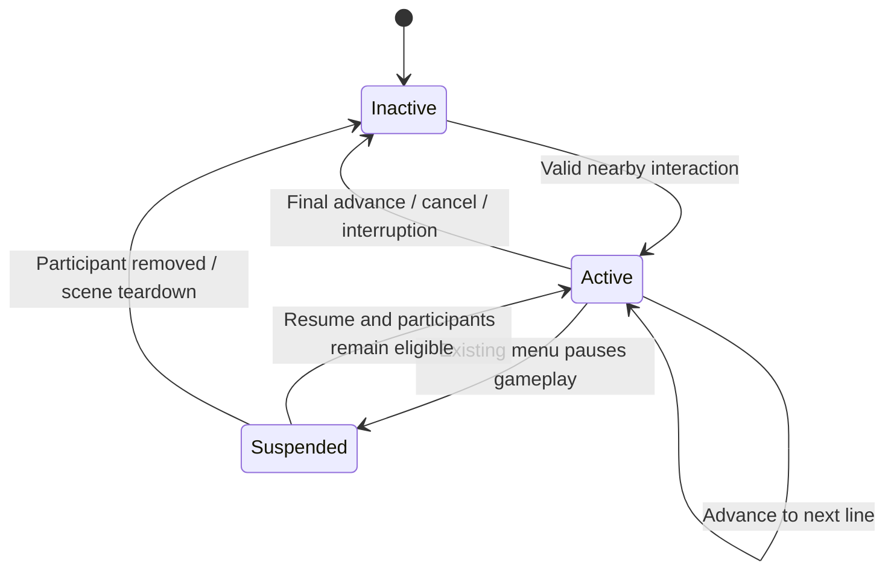

# Feature Overview

Introduce a stationary NPC that the player can approach and talk to while gameplay continues. Conversations display authored text, advance on explicit input, and end when completed, cancelled, or interrupted. Movement, aiming, spell casting, enemies, physics, and cooldowns continue during dialogue.

The first implementation supports linear conversations. Branching choices are a follow-up milestone after the basic interaction has been verified in gameplay.

## Goals

- Make NPC conversations usable without pausing or locking player controls.
- Separate nearby-target selection, NPC behavior, conversation configuration, runtime progression, and presentation.
- Use one interaction path for NPCs and checkpoints so nearby targets cannot compete for the same button press.
- Keep configuration resources free of runtime state and dependencies explicit.
- Establish safe interruption and cleanup behavior before adding narrative progression.

# Behavior Rules

## Nearby Interaction

- A player-owned `PlayerInteractor` selects one eligible nearby target and owns recognition of the `interaction` action.
- NPCs and checkpoints expose the same small interaction contract. They do not independently listen for the interaction action.
- Each target defines its interaction area. A target is eligible while the player overlaps that area and the target permits interaction.
- When several targets are eligible, select the nearest target origin to the player's global position. Keep the current selection on equal distances; otherwise use stable registration order to resolve ties.
- Reevaluate selection as the player or targets move. Remove targets safely when they leave the scene tree.
- Show one prompt for the selected target, such as `Talk` or `Use checkpoint`, together with the configured interaction binding.
- No eligible target means no prompt and no interaction request.
- One press requests at most one interaction. Held keys and repeated input events do not repeatedly open or advance conversations.
- While a conversation is active, interaction advances that conversation. Other NPCs and checkpoints cannot be activated until it ends.
- Rejected interaction requests do not start dialogue, change the checkpoint, or disturb an active conversation.

## Starting and Advancing Dialogue

- Interacting with an eligible NPC requests its exported conversation from the configured `DialogueSession`.
- A start succeeds only when the player and NPC are valid, the player is alive and in range, the conversation is valid, gameplay is not paused, and no conversation is already active.
- The session shows the first line immediately. The press that starts a conversation cannot also advance it.
- Each line displays a speaker name and text. Text appears in full and remains until the player advances or the conversation ends.
- Each subsequent interaction press advances exactly one line. Advancing past the final line completes the conversation and hides the panel.
- A dedicated cancel action ends the conversation immediately.
- Returning to an NPC after completion or interruption starts its conversation from the first line. There is no remembered progress in this milestone.
- The player may move, jump, aim, cast spells, and take damage while talking. Dialogue does not grant invulnerability, cancel movement modes, or change cooldowns.
- The NPC remains horizontally stationary and uses a solid `CharacterBody2D` with the same Entities layer (4) and World / One-way Platforms / Entities mask (7) as the player and enemies. Its body blocks player and enemy movement; its separate interaction area only detects eligible players.
- A composed `StationaryNpcBody` component applies the shared gravity behavior and calls `move_and_slide()` so the NPC settles onto terrain and one-way platforms. The NPC root needs no controller script.
- Use the existing dummy's blue knight idle sprite sheet, copied to `entities/npcs/village_guide/assets/idle_32x32.png`, with an eleven-frame looping idle animation and the same 3x scale used by the player and enemies. NPC artwork is owned by the NPC feature. Decorative polygon and line placeholders are removed.

## Interruptions and Pause

- Leaving the initiating NPC's interaction area ends the conversation with reason `out_of_range`. Being near a different NPC does not transfer the session.
- Losing positive health through `Health.damaged` ends the conversation with reason `damaged`. Zero damage does not interrupt it.
- Damage entirely absorbed by a shield does not interrupt dialogue in this milestone: the current `Health` contract does not emit `damaged` for shield-only absorption. Do not infer damage from generic health or shield refresh signals.
- `Health.depleted` or player respawn ends the conversation with reason `player_unavailable`, even if another termination signal occurs during the same event.
- Player removal, NPC removal, and scene teardown end the session safely. Termination happens at most once; the first reason received wins.
- Opening the existing pause menu pauses gameplay normally and suspends dialogue input. It preserves the current line and active conversation.
- The dialogue panel is hidden while gameplay is paused and restored from session state on resume. It must not advance, cancel, or reopen from the input used to dismiss a menu.
- On resume, revalidate the player, NPC, and interaction eligibility before accepting dialogue input. End the conversation if its participants are no longer eligible.
- Starting, completing, cancelling, interrupting, or destroying dialogue never writes `SceneTree.paused`. Pause ownership remains with existing menus.
- Switching scenes or restarting through the pause menu clears the old session and its signal subscriptions. It does not restore dialogue in the new scene.

## Input and Presentation

- Rebind `interaction` from keyboard S to E. S remains available for downward aiming and jump-down behavior.
- Add a controller binding for interaction on the right shoulder button, which is separate from the existing movement, spell, pause, and selection controls.
- Add `dialogue_cancel`, bound to Q and the right stick press. Escape continues to open the pause menu during dialogue.
- Keep action names configurable on the feature's input component. Prompt labels reflect the action bindings rather than embedding an E label in conversation data.
- Handle dialogue input once through `PlayerInteractor`; the panel does not install a second listener for advance or cancel.
- Use a compact panel near the bottom of the viewport with speaker, text, and advance/cancel hints. Layout must preserve readability alongside the player HUD and spell UI at the configured 1280 x 720 viewport.
- The panel does not grab keyboard focus or intercept gameplay mouse input. Hide the nearby interaction prompt while dialogue is active or gameplay is paused.
- Use explicit player input rather than automatic timed advancement. Typewriter animation, portraits, and voice audio are outside the first milestone.

# Scene Composition and Organization

```text
Main (existing composition root)
├── Level01
│   ├── Player
│   │   └── PlayerInteractor
│   ├── VillageGuide (CharacterBody2D)
│   │   ├── AnimatedSprite2D
│   │   ├── CollisionShape2D
│   │   ├── Gravity
│   │   ├── StationaryNpcBody
│   │   ├── InteractionTarget (Area2D)
│   │   │   └── CollisionShape2D
│   │   └── DialogueInteraction
│   └── Checkpoint (existing Area2D, interaction contract adapter)
├── DialogueSession
└── DialoguePanel (CanvasLayer)
    └── PanelContainer
        ├── SpeakerLabel
        ├── TextLabel
        └── InputHints
```

```text
entities/npcs/village_guide/
  VillageGuide.tscn
  conversations/introduction.tres
  assets/idle_32x32.png                  Copy of the existing blue knight idle sheet
entities/npcs/movement/
  stationary_npc_body.gd
entities/player/interaction/
  player_interactor.gd
  ui/                                   Nearby prompt presentation
components/interaction/
  interaction_target.gd                 Shared NPC/checkpoint contract
dialogue/
  dialogue_definition.gd
  dialogue_line.gd
  dialogue_session.gd
  interaction/dialogue_interaction.gd
  ui/
    DialoguePanel.tscn
    dialogue_panel.gd
tests/npcs_and_dialogue/
  test_npcs_and_dialogue.gd
  run_tests.sh
```

`InteractionTarget` belongs in shared components because both NPCs and checkpoints consume its contract. Adapt the checkpoint's existing area through this contract without adding a second independent detection/input system. Keep its menu and saved-position behavior inside the checkpoint feature.

| Component | Responsibility |
| --- | --- |
| `PlayerInteractor` | Maintain nearby candidates, select one target, recognize interaction/cancel input, route requests, and provide prompt state. |
| `InteractionTarget` | Report eligible player overlap, prompt text, and interaction availability; expose a request entry point for its owning feature. |
| `VillageGuide` | Compose animated NPC presentation, solid body collision, stationary movement, an interaction target, and dialogue behavior without an NPC controller script. |
| `StationaryNpcBody` | Keep horizontal velocity at zero, apply the shared gravity component, and move the configured character body against terrain and entities. |
| `DialogueInteraction` | Bind a target to a configured conversation and session; report whether starting dialogue was accepted. |
| `DialogueDefinition` | Store ordered, shared conversation configuration. |
| `DialogueLine` | Store one speaker name and text. |
| `DialogueSession` | Own the active conversation and line index, validate transitions, subscribe to interruption sources, and terminate once. |
| `DialoguePanel` | Observe the session, display its current line, and derive visibility from session and pause state. |
| `Main` | Supply session, player lifecycle dependencies, NPC bindings, and UI references explicitly. |
| `Checkpoint` | Open its existing menu after selection by `PlayerInteractor`; retain Save/Back responsibilities. |

# Public Contracts and State Ownership

## Configuration

- `DialogueLine` is a resource with `speaker_name: String` and `text: String`. Both must contain visible text.
- `DialogueDefinition` is a resource with `lines: Array[DialogueLine]`. It requires at least one valid line, with no null entries.
- Validate the complete definition before accepting a start, so malformed later lines cannot produce a partially accepted conversation.
- Resources contain no current index, completion flag, player references, or signal subscriptions. The session treats them as read-only.
- NPC scenes compose `DialogueInteraction`, which exports its conversation, session, and interaction-target references. NPC root nodes need no dialogue methods or script. Detection masks, area shapes, prompt text, and panel presentation remain scene-configurable.

## Interaction API

- `InteractionTarget.can_interact(player: Node2D) -> bool`: report current eligibility without side effects.
- `InteractionTarget.try_interact(player: Node2D) -> bool`: request the owning feature's behavior and report whether it was accepted.
- `InteractionTarget.get_prompt() -> String`: provide target-owned action text.
- Candidate entry/exit and availability changes notify `PlayerInteractor`; it derives the selected prompt rather than keeping another interaction-availability flag in UI.
- Detect eligible players through the `player` group. Supply session, health, and respawn references explicitly; do not discover them through arbitrary scene paths.
- Recheck eligibility at request time, even if a target was previously selected.

## Dialogue Interaction API

- `DialogueInteraction.setup(dialogue_session: DialogueSession) -> void`: receive the session from the composition root, validate configuration, and bind the target handler. An exported session also permits binding during `_ready()`.
- `DialogueInteraction.try_interact(player: Node2D) -> bool`: recheck eligibility and request `session.try_start(conversation, player, target)`, returning the acceptance result.
- `Main` supplies the session directly to the component. The component does not discover an NPC controller or depend on a specific NPC class.
- Failed setup leaves the component unbound and reports a configuration error. Removing the component clears its own handler without overwriting a replacement installed by another owner.

## Session API

- `try_start(definition: DialogueDefinition, player: Node2D, target: InteractionTarget) -> bool`.
- `advance() -> bool`: advance or complete an eligible active conversation; reject when inactive or paused.
- `cancel() -> bool`: end an active conversation on explicit cancellation; reject when inactive or paused.
- `is_active() -> bool` and `get_current_line() -> DialogueLine` expose current state; the line query returns null while inactive.
- `started`, `line_changed(line: DialogueLine)`, and `ended(reason: StringName)` signals publish accepted changes. Consumers initialize themselves from current state when connected.
- Publish `started` before the initial `line_changed`. Clear active references and disconnect interruption sources before publishing `ended`.
- Ending an already ended session is an idempotent no-op. Rejected starts and transitions emit no state-change signals.
- One application-scene `DialogueSession` owns one active conversation for the single player. Compose it in `Main`; an autoload is unnecessary.



`Suspended` describes the active session while the tree is paused; derive it from the existing pause state rather than maintaining a second pause owner. An invalid participant discovered on resume also ends the session.

# Failure Handling and Cleanup

- Missing required scene references produce a clear configuration error and disable the affected interaction safely.
- Missing, empty, or invalid dialogue definitions reject the start without changing an existing session or creating UI instances.
- Repeated start requests do not replace the current session or duplicate signal connections.
- Invalid or freed targets are removed from candidate selection and cannot receive new interaction requests.
- Disconnect health, respawn, target-exit, and participant-removal subscriptions when the conversation ends or the session is destroyed. An old NPC's signals must not affect a later conversation.
- Keep one reusable panel instance owned by `Main`. Clear its displayed data when the session ends; conversation starts do not accumulate panels.
- Dialogue does not modify health, movement, inventory, spell availability, or checkpoint state. Future rewards must use their owning features' public APIs.

# Scope Limits

The first milestone includes one stationary friendly NPC, ordered text conversations, nearby selection shared with checkpoints, explicit advancement/cancellation, live gameplay, pause integration, and safe interruptions.

Branching choices, conditional dialogue, quests, rewards, persistent conversation history, save/load, localization infrastructure, NPC navigation, patrol movement, combat reactions, hostile NPCs, cinematic camera control, voice audio, and dialogue-authoring tools are outside this milestone. The NPC has no health or attack/action receiver until concrete behavior requires them.

After verifying the linear loop, specify branching separately: choice IDs, transitions, validation, and controls that do not consume movement or spell inputs. Do not add unused graph or scripting abstractions to the linear implementation.

# Implementation Plan

1. Implement configuration validation and the session lifecycle; verify progression, rejection, resource isolation, and termination independently.
2. Implement the shared interaction contract and player selection, including prompt state and the new input bindings.
3. Adapt checkpoints to the selected-target path. Preserve their pause, Save, Back, spawn-marker, and duplicate-menu behavior from `010_checkpoint.md`; update its interaction documentation and tests for the new routing and binding.
4. Build `VillageGuide.tscn` and an introduction resource. Place the NPC on reachable terrain in `Level01` and wire dependencies through `Main` and explicit setup/exported references.
5. Build the observing panel, route advance/cancel through `PlayerInteractor`, and connect interruption and pause behavior.
6. Add component and integration coverage, run affected existing suites, and manually verify presentation and simultaneous gameplay input.

# Acceptance Criteria and Verification

## Automated Checks

Use standalone `SceneTree` tests and the shared runner described in `docs/TESTING.md`. Run `bash tests/npcs_and_dialogue/run_tests.sh` for feature coverage.

1. Eligible NPC interaction starts one conversation and displays its first line without pausing the tree.
2. The opening event does not advance a line. Each later fresh press advances once; held/repeated events do not skip text.
3. Final advance completes once, clears the panel, and allows a later conversation to restart at line one.
4. Cancellation ends once. Inactive and paused transitions reject safely without changing progress.
5. Two sessions referencing the same definition have independent indices and leave the resource unchanged.
6. Multiple nearby NPCs/checkpoints produce one selected target and one interaction request, with deterministic tie handling. Moving between targets updates the prompt.
7. No target, out-of-range targets, unavailable targets, invalid configuration, and invalid definitions reject without unrelated effects.
8. Leaving the initiating target, positive health damage, death, respawn, and participant removal terminate safely. Shield-only absorption and zero damage do not interrupt.
9. Several interruption signals during one event emit `ended` at most once. Signals from an earlier conversation cannot end a later one.
10. Movement, aiming, casting, enemy updates, physics, and cooldown progression remain active during dialogue.
11. Pause hides dialogue and suppresses dialogue input while preserving the current line. Resume restores eligible dialogue without advancing it. Scene restart/removal clears it safely.
12. An active conversation prevents interactions with other NPCs and checkpoints. Once it ends, normal target selection resumes.
13. Checkpoint Save, Back, focus, duplicate protection, and respawn behavior still pass through the new interaction route.
14. Ending dialogue never changes the tree's paused state. Repeated conversations do not accumulate panels or signal connections.
15. Input bindings separate interaction/cancel from movement, aim, jump, spell tokens, pause, and selection.
16. Dialogue works on a plain `Node2D` composed with `InteractionTarget` and `DialogueInteraction`, without an NPC-specific script. The component preserves acceptance/rejection results and unbinds safely on removal.
17. The guide uses its own copy of the existing idle sprite sheet and loops all eleven frames.
18. The guide falls onto solid terrain and one-way platforms, remains horizontally stationary, and blocks the real player and enemy bodies without applying combat effects. Interaction remains usable beside its solid body.

Run the new feature suite plus the existing checkpoint and standards suites. Include relevant movement/combat suites if integration changes affect those paths, following `docs/TESTING.md`.

## Manual Verification

- Approach the NPC, read and advance text, walk/jump while talking, cast a spell, and leave range. Confirm the conversation never freezes gameplay.
- Take enemy damage during a conversation and verify immediate dismissal while the normal damage/knockback pipeline continues.
- Pause/resume while reading, then restart or leave the scene from the menu. Verify focus, panel visibility, and cleanup.
- Test keyboard and controller prompts, advancement, cancellation, and simultaneous movement/aiming. Confirm S no longer opens NPCs or checkpoints.
- Check readability alongside the existing HUD, spell sequence, cooldown entries, and item notifications at the configured viewport.
- Place overlapping NPC/checkpoint interaction areas and verify selection, prompt clarity, and that one press cannot open multiple features.
- Verify the copied sprite animation, scale, and ground alignment in `Level01`. Walk and jump against the NPC and confirm dialogue still works from beside it.
